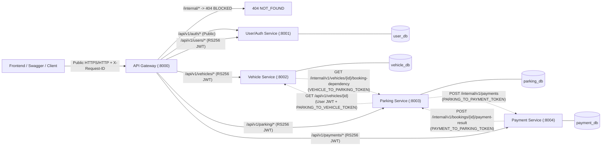
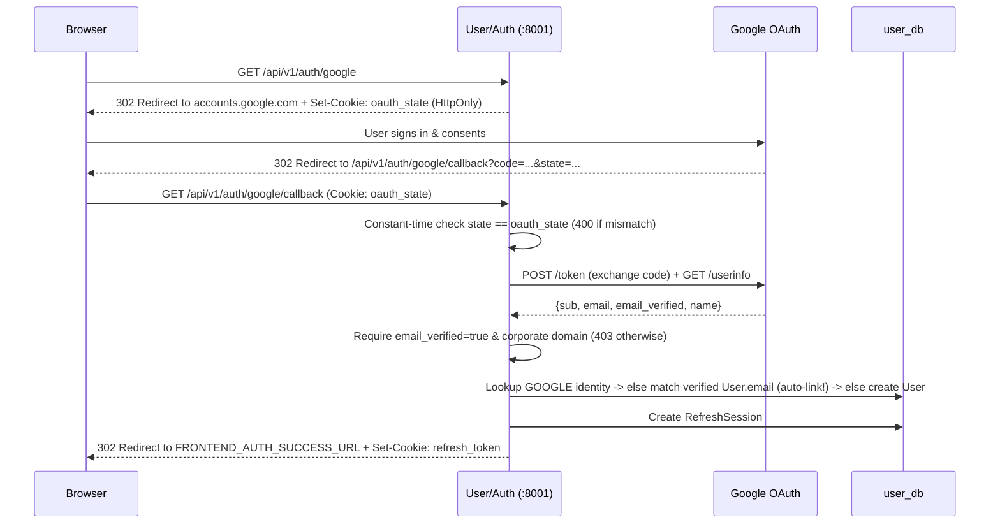
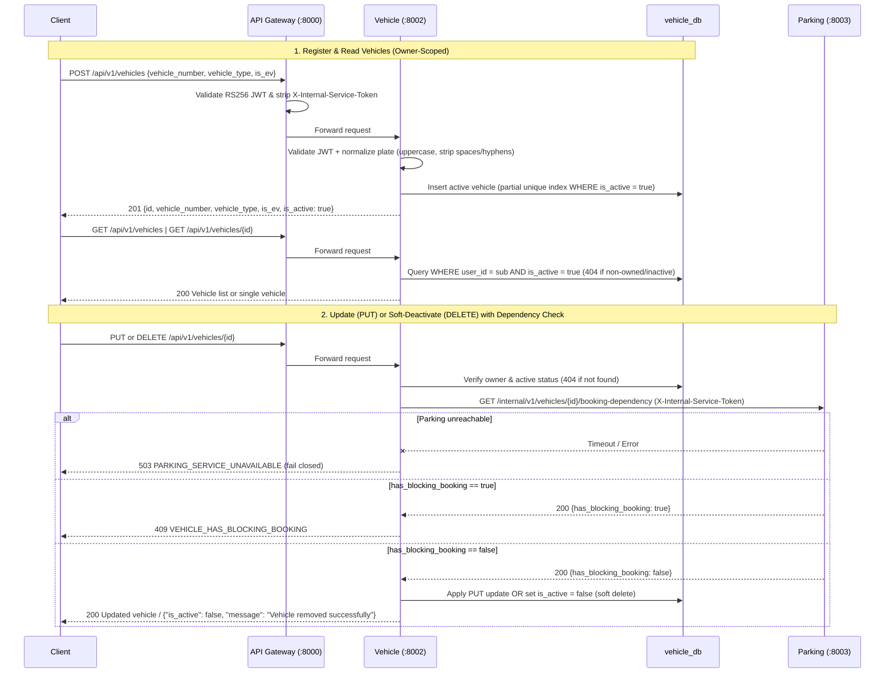
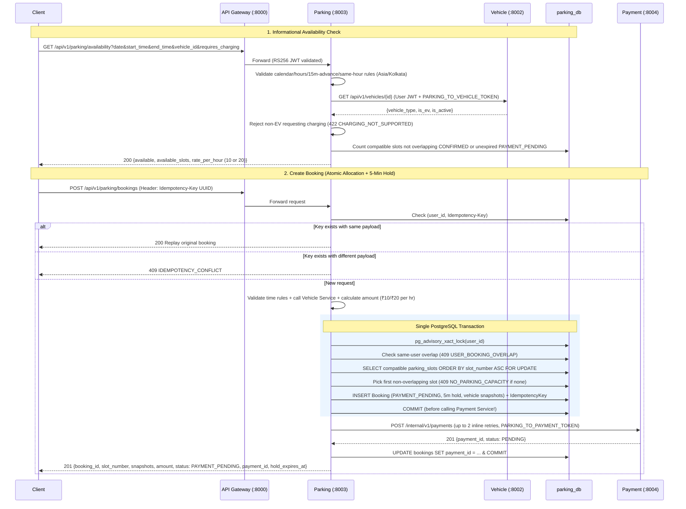
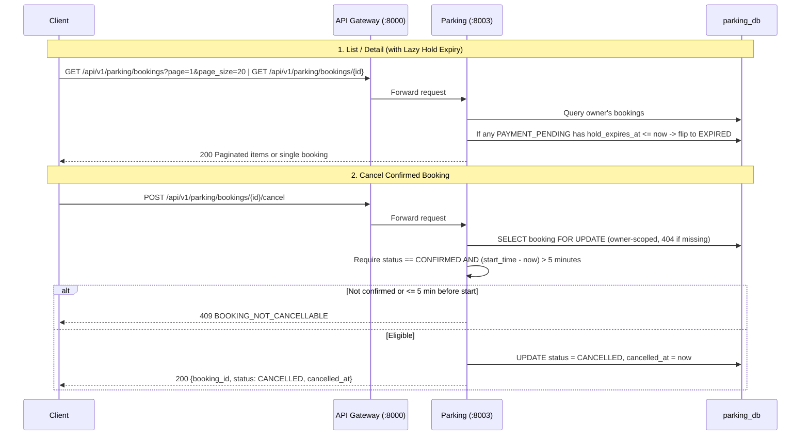
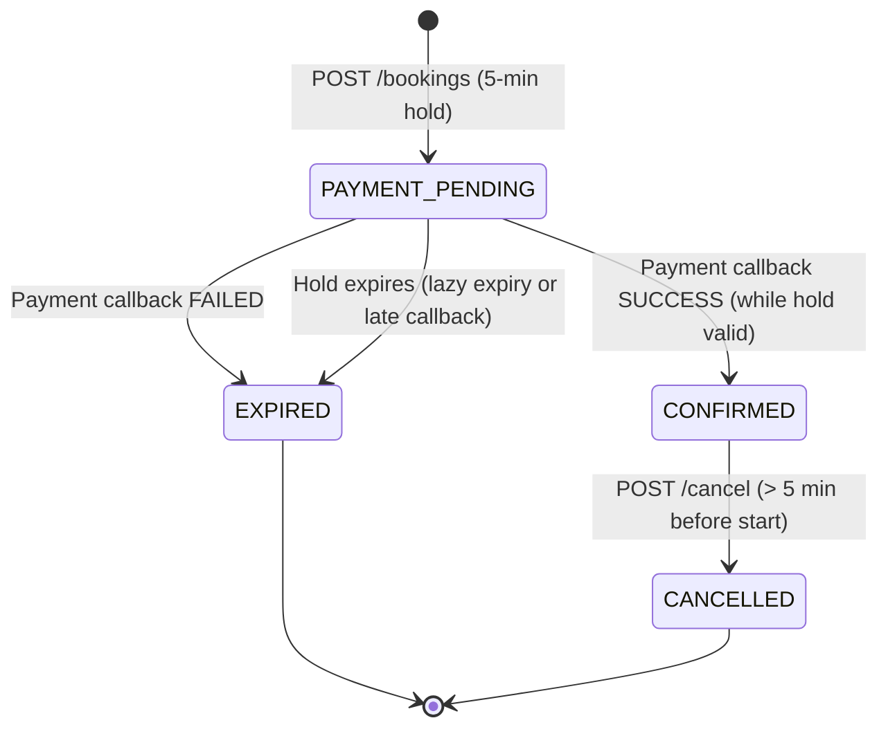
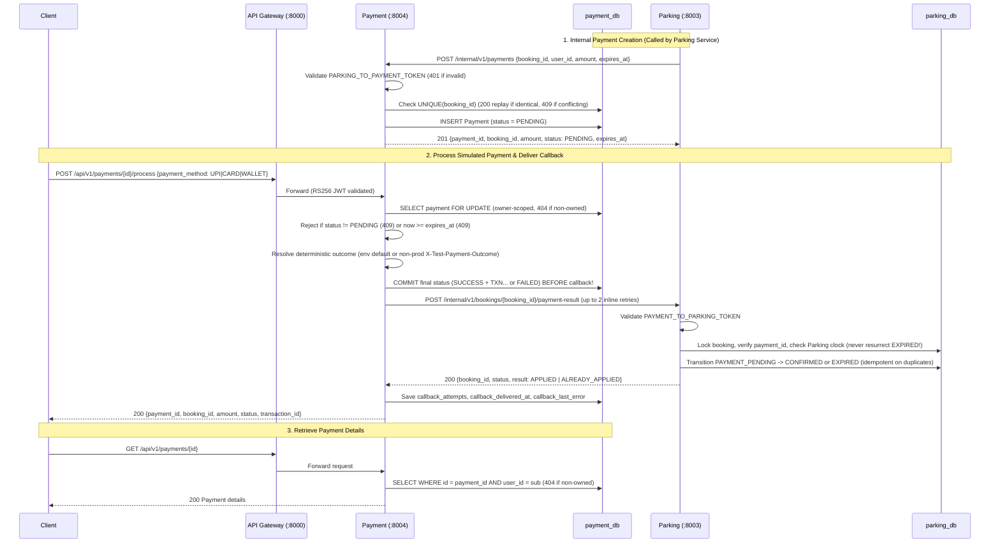
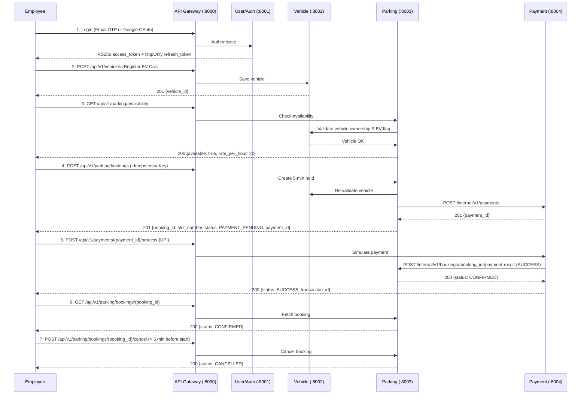

# Corporate Parking Reservation System — API Flow Diagrams

Visual guide to all **22 APIs** across the **API Gateway** (`8000`) and **4 Business Microservices** (`8001`–`8004`), reflecting the implemented codebase.

---

## 1. System Overview & API Gateway Routing (`gateway/` — Port `8000`)

The Gateway is infrastructure-only (no database, no business logic). It enforces early RS256 JWT validation on protected routes, blocks `/internal/v1/*` with `404`, strips any externally supplied `X-Internal-Service-Token`, and forwards `X-Request-ID`. Internal service-to-service calls bypass the Gateway.



---

## 2. User/Auth Service (`services/user-auth-service` — Port `8001`, 7 APIs)

### 2.1 Company Email OTP, Profile, Token Refresh & Logout

```mermaid
sequenceDiagram
    participant C as Client
    participant GW as API Gateway (:8000)
    participant A as User/Auth (:8001)
    participant DB as user_db
    participant Mail as EmailSender (Console/SMTP)

    Note over C,Mail: 1. Send Corporate Email OTP
    C->>GW: POST /api/v1/auth/company/send-code {email}
    GW->>A: Forward request
    A->>A: Normalize email & check COMPANY_EMAIL_DOMAIN (403 if invalid)
    A->>DB: Check 60s resend cooldown (429 if too soon)
    A->>DB: Invalidate old active codes & insert HMAC-SHA256 OTP (5m TTL)
    A->>Mail: send_otp(email, 6-digit code)
    A-->>C: 200 {"message": "Verification code sent successfully"}

    Note over C,Mail: 2. Verify OTP & Issue Tokens
    C->>GW: POST /api/v1/auth/company/verify {email, code}
    GW->>A: Forward request
    A->>DB: Load latest active VerificationCode
    alt Wrong code
        A->>DB: Increment attempt_count (invalidate & 429 at max 5)
        A-->>C: 401 INVALID_OR_EXPIRED_CODE
    else Valid code
        A->>DB: Mark consumed_at; find/create User & COMPANY_EMAIL AuthIdentity
        A->>DB: Insert SHA-256 RefreshSession (7d TTL)
        A-->>C: 200 {access_token (RS256 15m), user} + Set-Cookie: refresh_token (HttpOnly)
    end

    Note over C,Mail: 3. Fetch Current Profile
    C->>GW: GET /api/v1/users/me (Authorization: Bearer JWT)
    GW->>GW: Early RS256 JWT validation
    GW->>A: Forward request
    A->>DB: Lookup User by JWT sub
    A-->>C: 200 {id, email, name}

    Note over C,Mail: 4. Refresh Token Rotation & Logout
    C->>GW: POST /api/v1/auth/refresh (Cookie: refresh_token)
    GW->>A: Forward with cookie
    A->>DB: Validate unrevoked/unexpired session -> revoke old -> insert new session
    A-->>C: 200 {new access_token} + Set-Cookie: rotated refresh_token

    C->>GW: POST /api/v1/auth/logout (Cookie: refresh_token)
    GW->>A: Forward with cookie
    A->>DB: Set revoked_at on session (idempotent)
    A-->>C: 200 {"message": "Logged out successfully"} + Clear cookie
```

### 2.2 Google OAuth 2.0 & Verified Account Linking



---

## 3. Vehicle Service (`services/vehicle-service` — Port `8002`, 5 APIs)



---

## 4. Parking Service (`services/parking-service` — Port `8003`, 5 Public + 2 Internal APIs)

### 4.1 Availability & Atomic Booking Creation (Locking + Idempotency + Hold)



### 4.2 Booking History, Lazy Hold Expiry & Cancellation



### 4.3 Booking State Machine



---

## 5. Payment Service (`services/payment-service` — Port `8004`, 1 Internal + 2 Public APIs)



---

## 6. Complete End-to-End User Journey (All 5 Apps)


