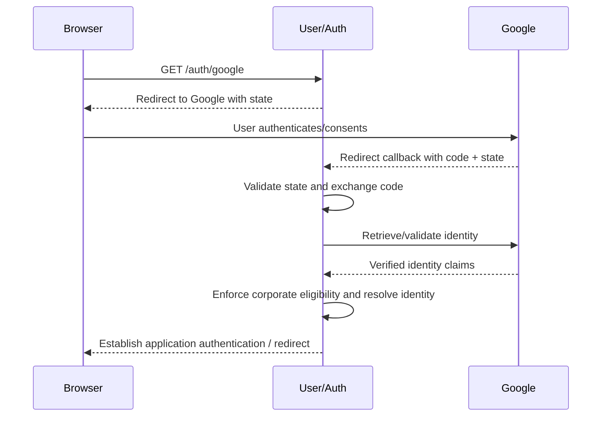

# End-to-End Workflows and Reliability

**Document status:** Workflow design baseline. Business transitions already agreed are marked as such; implementation mechanisms that need confirmation are marked Proposed or Open.

## 1. Purpose

This document joins the service-level API contracts into complete user journeys. It records state transitions, transaction boundaries, concurrency expectations, timeout handling, retries, expiry processing and known distributed-system failure windows.

## 2. Core workflows at a glance

1. Company email authentication or Google OAuth.
2. Vehicle registration and maintenance.
3. Informational parking availability lookup.
4. Booking creation, temporary hold and payment creation.
5. Simulated payment processing and callback to Parking.
6. Booking history/detail retrieval.
7. Confirmed booking cancellation.
8. Hold expiry and callback retry/recovery.

## 3. Company email verification workflow

```mermaid
sequenceDiagram
    participant FE as Frontend
    participant GW as Gateway
    participant UA as User/Auth
    participant EP as Email Provider
    FE->>GW: POST send-code(email)
    GW->>UA: Forward request
    UA->>UA: Normalize email; validate allowed domain
    UA->>UA: Generate code; store protected hash + expiry
    UA->>EP: Send plaintext code by email
    EP-->>UA: Delivery result
    UA-->>FE: Code sent (no code in response)
    FE->>GW: POST verify(email, code)
    GW->>UA: Forward request
    UA->>UA: Verify hash, expiry, attempts and one-time use
    UA->>UA: Find/create user and identity
    UA-->>FE: Application authentication result
```

Agreed/planned behavior:
- Code lifetime: five minutes.
- Only the latest active code is valid.
- Previous active code is invalidated when a new code is issued.
- Maximum attempts proposal: five per code; rate limits apply to send and verify.
- Successful code is consumed and cannot be replayed.
- First successful login may create the application user; an existing identity resolves to the existing user.

Open details: resend cooldown, rate-limit thresholds, code retention, token/session lifetime and user display-name collection.

## 4. Google OAuth workflow



OAuth `state`, token validation, Google `email_verified = true`, and corporate eligibility checks are required. PKCE is recommended where supported. **Agreed account linking:** if the verified corporate email matches an existing OTP-verified corporate email, both provider identities in `auth_identities` are linked to the same `users` record (never link on an unverified email).

## 5. Vehicle registration and selection workflow

1. Authenticated user submits `POST /api/v1/vehicles`.
2. Vehicle Service derives `user_id` from authenticated identity.
3. Normalize vehicle registration number and validate type (`CAR`/`BIKE`) and `is_ev`.
4. Enforce owner-scoped uniqueness and persist the vehicle.
5. Return the registered vehicle.
6. For booking, frontend calls `GET /api/v1/vehicles` and user selects a saved vehicle.

**Agreed dependency check:** before updating or deactivating a vehicle, Vehicle Service calls Parking Service's approved internal endpoint `GET /internal/v1/vehicles/{vehicle_id}/booking-dependency`. A future or currently active `CONFIRMED` booking, or a valid unexpired `PAYMENT_PENDING` booking, blocks mutation (`409 Conflict`). Historical, `CANCELLED`, `EXPIRED`, and already-ended bookings do not block. If Parking Service is unreachable, Vehicle Service fails closed (`503`).

**Agreed historical display policy:** bookings retain `vehicle_id` and also capture immutable vehicle snapshots (`vehicle_number_snapshot`, `vehicle_type_snapshot`, `is_ev_snapshot`) at booking creation time so historical booking views remain accurate even if the vehicle is later updated or deactivated.

## 6. Availability workflow

1. Frontend selects a registered vehicle and supplies date, start, end and `requires_charging`.
2. Gateway authenticates and routes to Parking.
3. Parking validates request shape and time/date policy.
4. Parking calls Vehicle Service to validate ownership and retrieve type/EV/active status.
5. Parking identifies compatible slots.
6. Parking checks overlapping `CONFIRMED` bookings and `PAYMENT_PENDING` bookings with unexpired holds.
7. Parking returns the currently available count and rate.

**Important:** availability is an informational snapshot, not a reservation or promise. The create-booking transaction must repeat authoritative checks.

## 7. Booking creation and payment initiation

### 7.1 Intended sequence

```mermaid
sequenceDiagram
    participant FE as Frontend
    participant GW as Gateway
    participant P as Parking
    participant V as Vehicle
    participant PDB as Parking DB
    participant PAY as Payment
    participant PAYDB as Payment DB
    FE->>GW: POST bookings(vehicle, time, charging)
    GW->>P: Authenticated request
    P->>V: Validate owner + active vehicle attributes
    V-->>P: Vehicle details
    P->>PDB: Begin transaction; serialize user; lock candidate slot
    P->>PDB: Re-check overlap/capacity; insert PAYMENT_PENDING + hold
    PDB-->>P: Commit booking hold
    P->>PAY: Create payment (booking ID, user ID, amount, expiry)
    PAY->>PAYDB: Insert or return idempotent payment
    PAY-->>P: Payment ID + PENDING
    P->>PDB: Save payment_id on booking
    P-->>FE: Booking PAYMENT_PENDING + payment ID
```

### 7.2 Transaction boundary

The Parking database transaction covers:
- serialization/check for same-user overlapping requests;
- locking candidate slot row(s);
- re-checking active slot conflicts;
- calculating and persisting amount;
- inserting the `PAYMENT_PENDING` booking and five-minute hold.

The transaction must commit before calling Payment Service. A database transaction cannot atomically include a separate Payment Service database transaction without distributed transaction coordination, which is intentionally not part of this project.

Saving the returned `payment_id` to the booking is a second Parking DB write after Payment responds. The exact recovery if that write or the payment call fails must be covered by idempotency and reconciliation; it is not safe to pretend the whole cross-service sequence is one ACID transaction.

### 7.3 Booking creation safeguards

- Payment create is idempotent by `booking_id`.
- **Agreed booking-create idempotency:** `POST /api/v1/parking/bookings` requires a client-generated UUID `Idempotency-Key` header, persisted in Parking Service and uniquely scoped to the authenticated user (`user_id` + `idempotency_key`). Same user + same key + same payload returns the original booking result; same user + same key + different payload returns `409 Conflict`.
- Same-user requests must be serialized or equivalently protected so two simultaneous requests cannot both pass the no-overlap check.
- Candidate slot rows must be locked and conflicts rechecked inside the same database transaction.
- Booking IDs and payment IDs are generated by their owning services.

### 7.4 Failure after hold creation

If Parking commits a hold but Payment Service is unavailable:
1. Parking retries the idempotent create-payment operation using the same booking ID and immutable request values, within a bounded request/retry budget.
2. It must not create another booking or another hold as an automatic retry.
3. If payment creation cannot be established before hold expiry, the booking expires and capacity is released by derived availability.
4. A cleanup/reconciliation process must handle the booking's status and any eventual Payment record consistently.

The exact synchronous retry count, API response behavior and recovery if Payment actually created the record but the response was lost remain decisions in the register.

## 8. Slot compatibility and allocation

Slot type must match the vehicle type. If charging is requested, the slot must be charging-enabled. An EV that does not request charging may use a normal slot.

The allocation selection policy itself was not explicitly frozen. A simple deterministic first-available slot (for example, ascending `slot_number`) is the recommended MVP approach because it is explainable and sufficient for 100 spaces. It is a proposal, not an agreed optimization rule.

## 9. Concurrency and transaction correctness

Two distinct conflicts must be prevented:

### 9.1 Same slot, different users

Two users may race for the final compatible slot. Parking must lock a candidate slot row and re-check overlapping active bookings before inserting. Only one transaction may successfully claim that candidate for overlapping time.

### 9.2 Same user, different slots

A single user can send two simultaneous requests for overlapping periods. Slot locks alone do not prevent the user-level conflict if the two requests obtain different slots. Parking must serialize per-user booking creation or use another reliable database-level strategy before checking user overlap.

### 9.3 Interval semantics

Intervals are half-open: `[start, end)`. The overlap condition is:

```text
new_start < existing_end AND new_end > existing_start
```

An interval ending at 10:00 does not overlap another beginning at 10:00.

### 9.4 PostgreSQL implementation direction

A candidate design is:
- start a database transaction;
- acquire a per-user transaction-scoped lock or equivalent serialization mechanism;
- query compatible slot records in deterministic order with row locking (a `FOR UPDATE`/`SKIP LOCKED` strategy may be evaluated);
- re-check conflicting bookings for each locked slot using the current transaction;
- insert the pending booking and commit.

This is a design direction, not final SQL. The exact locking strategy, deadlock behavior, transaction isolation and indexes must be selected and tested before implementation. A simple unique constraint does not prevent arbitrary time-range overlap.

## 10. Payment processing and callback workflow

```mermaid
sequenceDiagram
    participant FE as Frontend
    participant PAY as Payment
    participant PAYDB as Payment DB
    participant P as Parking
    participant PDB as Parking DB
    FE->>PAY: POST /payments/{id}/process(method)
    PAY->>PAYDB: Lock payment; validate owner/status/expiry
    PAY->>PAYDB: Persist deterministic/backend-controlled SUCCESS or FAILED
    PAY-->>FE: Final simulated payment result
    PAY->>P: Internal payment-result callback
    P->>PDB: Lock booking; validate payment ID + hold expiry
    alt Success while hold valid
      P->>PDB: PAYMENT_PENDING -> CONFIRMED
    else Failure or expired hold
      P->>PDB: PAYMENT_PENDING -> EXPIRED
    end
    P-->>PAY: Acknowledge result (including idempotent duplicate)
```

Payment Service must durably store the final payment result before attempting callback delivery. The frontend payment response means the simulated result was stored; it does not independently prove that Parking has already changed the booking to `CONFIRMED`. The frontend should retrieve the booking to display its authoritative status.

## 11. Callback reliability (Sprint Demo Baseline)

**Agreed for sprint demo:** inline delivery with bounded retries (no background polling daemon):

1. Store `SUCCESS`/`FAILED` in `payment_db` first.
2. Immediately attempt `POST /internal/v1/bookings/{booking_id}/payment-result` with up to **2 inline retries** (0.5s pause) on timeout/5xx/network failure.
3. Record `callback_delivered_at`, `callback_attempts`, and sanitized `callback_last_error` in `payments`.
4. Parking callback remains idempotent because retries can produce duplicate deliveries.

A separate background retry worker/outbox table is deferred to future production hardening.

## 12. Hold expiry and stale booking cleanup (Sprint Demo Baseline)

A `PAYMENT_PENDING` booking blocks capacity only while `hold_expires_at` is in the future (`hold_expires_at > now()`).

**Agreed for sprint demo (lazy expiry — no background worker):**
- Availability and overlap queries always ignore `PAYMENT_PENDING` rows where `hold_expires_at <= now()`.
- Whenever `GET /api/v1/parking/bookings`, `GET /api/v1/parking/bookings/{booking_id}`, or `POST /internal/v1/bookings/{booking_id}/payment-result` encounters a `PAYMENT_PENDING` row whose `hold_expires_at <= now()`, Parking Service transitions it to `EXPIRED` on access.

A periodic background cleanup task is deferred to future production hardening.

## 13. Cancellation workflow

1. Authenticated user calls the cancel endpoint.
2. Parking loads and locks the booking scoped by owner.
3. Require `CONFIRMED` state.
4. Compare current business-zone time with booking start instant.
5. Permit cancellation only when strictly more than five minutes remain.
6. Change state to `CANCELLED`, record `cancelled_at`, commit.

No payment refund is performed in the current simulated scope. No slot-release operation is called; cancelled bookings no longer block availability.

## 14. Important edge cases

| Scenario | Expected handling |
|---|---|
| Availability says free, another user books first | Create-booking transaction rechecks; later caller gets another compatible slot or `409 NO_PARKING_CAPACITY` |
| Two users race for final compatible slot | Lock/recheck allows at most one overlapping claim |
| Same user submits simultaneous overlapping requests | Per-user serialization prevents both succeeding |
| Client retries a timed-out create-booking POST | Returns the original booking when the same `Idempotency-Key` and payload are sent by the same user (`409 Conflict` if payload differs) |
| Payment creation response is lost after Payment inserted row | Retry by booking ID returns same payment |
| Payment Service unavailable after hold commit | Bounded retry; hold expires if payment cannot be established; no duplicate booking |
| Callback arrives twice | Identical duplicate is acknowledged without repeating transition |
| Callback arrives after hold expiry | Booking remains/becomes `EXPIRED`; no resurrection |
| Payment succeeds but callback cannot be delivered for a long period | Payment remains final; callback worker retries; booking may expire. For real money this requires refund/reconciliation, which is outside current simulation scope |
| User tries to cancel at exactly start minus five minutes | Reject; rule is strictly more than five minutes |
| Vehicle Service unavailable during booking | Fail closed; do not allocate using unverified vehicle data |
| Vehicle is updated or deactivated while blocking booking exists | Rejected with `409 Conflict` via approved internal Parking dependency check (`GET /internal/v1/vehicles/{vehicle_id}/booking-dependency`) |

## 15. State transitions

### Booking

```text
PAYMENT_PENDING
  ├── SUCCESS while hold valid ──> CONFIRMED
  ├── FAILED ────────────────────> EXPIRED
  └── hold expires ──────────────> EXPIRED

CONFIRMED
  └── eligible cancellation ────> CANCELLED
```

No same-booking payment retry, booking modification, extension, session, no-show or refund state is in current scope.

### Payment

```text
PENDING
  ├── simulated success ──> SUCCESS
  └── simulated failure ──> FAILED
```

`SUCCESS` and `FAILED` are terminal for a single payment attempt.

## 16. Time and clock authority

- Business calendar and booking hours use `Asia/Kolkata`.
- Booking date and start/end values are local calendar/time values.
- Expiry, creation, cancellation and callback event timestamps are instants and should use timezone-aware timestamps (`TIMESTAMPTZ`).
- Parking Service/database time is authoritative for hold expiry and cancellation decisions.
- Services must synchronize host clocks in deployment; do not base an authorization/state transition on an untrusted client clock.

## 17. Reliability decisions (m0 finalized)

All core reliability decisions are finalized for the sprint demo baseline in `decisions-and-open-questions.md`:
- Concurrency: single `READ COMMITTED` transaction with `pg_advisory_xact_lock` per user + `FOR UPDATE` on compatible `parking_slots` ordered by `slot_number ASC` + overlap recheck.
- Hold expiry: lazy expiry on availability/read/callback (no background worker).
- Payment create & callback: up to 2 inline retries (3s timeout on create; 0.5s pause on callback) with DB tracking (`callback_delivered_at`, `callback_attempts`, `callback_last_error`).
- Repeated `/process`: returns `409 PAYMENT_ALREADY_PROCESSED`.
- Production background workers, dead-letter alerts, and refund reconciliation remain future scope.
